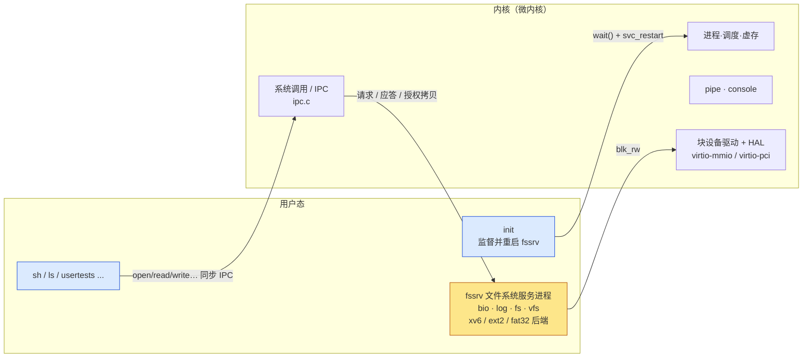

# proj7：xv6 微内核化重构 — 设计文档

基础：`proj6`（xv6-riscv rev5 + VFS + HAL，支持 RISC-V / LoongArch，xv6 / ext2 / fat32）。
目标：文件系统等非核心功能移出内核，成为用户态服务进程，与内核及客户端通过 IPC 通信；原有测例全部通过；增加的代码尽量少。

## 1. 结果概览

| 内核中删除 | 现在位置 |
|---|---|
| `bio.c block.c log.c fs.c vfs.c ext2.c fat32.c`（约 4 900 行） | `src/fssrv/`，**原样搬迁**，与原文件相比仅 7 行 diff（`namex` 取 cwd 的方式） |
| `sysfile.c` 中的路径操作逻辑（create/unlink/link/open…） | `fssrv/main.c`；内核 `sysfile.c` 只剩参数检查与 IPC 存根 |
| inode 表、挂载表、文件偏移 | 全部在服务进程内 |

内核仍保留：进程/调度/虚存、陷入与中断、管道、控制台、**块设备驱动与 HAL**（见 §7 的取舍）、IPC。

## 2. IPC 机制（`kernel/ipc.[ch]`）

* **同步、会合式**：客户端的系统调用被转成一个 `struct ipcmsg` 请求，内核把它排给该服务唯一的服务进程并让客户端睡眠，服务进程回复后唤醒。每个服务一个请求槽（`busy`），其余客户端在槽上排队。
* **消息只放小参数**：操作码、句柄、两个数值参数、两条路径（`MAXPATH`）。大块数据不进消息。
* **授权拷贝（grant）**：客户端调用时把一块缓冲区 `[gaddr, gaddr+glen)` 授权给本次请求；服务进程通过 `svc_xfer(dir, addr, buf, n)` 读写，内核检查地址落在授权区间内、且请求仍在进行中。内核自己的 `exec` 装载也用同一机制（授权区是内核缓冲区）。这样服务进程无法触碰任意进程的内存。
* **客户端睡眠不可被 kill 打断**：服务进程可能正在写它的内存，所以只能等到应答或服务死亡。
* **服务端系统调用**：`svc_register` `svc_recv` `svc_reply` `svc_xfer` `blk_rw`；客户端/监督用：`svc_pid` `svc_restart`。

## 3. 句柄模型：内核不再知道 inode

`struct file` 新增 `FD_REMOTE`：只保存服务进程发的**句柄**与服务的**代数（gen）**。引用计数、`dup`、`fork` 继承等 xv6 语义仍在内核的 `struct file` 上完成，文件偏移保存在服务进程的句柄里（所以 dup/fork 后共享偏移的语义不变）。当前目录同样是服务进程里的一个句柄（`proc.cwdh`），`fork` 时发 `FS_DUP`，`exit` 时发 `FS_CLOSE`。

控制台等设备文件：`open` 返回 `T_DEVICE` 与主设备号，内核据此建 `FD_DEVICE` 文件，读写仍走 `devsw`，不经过服务进程——所以文件系统挂掉时 shell 与控制台照常工作。

## 4. 启动与自举

文件系统服务的 ELF 以 `.incbin`（`kernel/bootmod.S`）链接进内核镜像，作为 **boot module**：`userinit` 创建两个进程——pid 1 `fssrv`（由内核直接用内存镜像 `kexec_image` 装载，控制台作 fd 0–2）和 pid 2 `init`（`initproc`，孤儿进程的收养者）。`init` 等服务注册后再从磁盘 `exec /init`。`svc_register` 只有内核从 boot module 启动的进程才能调用。

## 5. 故障隔离与恢复

| 事件 | 内核行为 | 客户端看到 |
|---|---|---|
| 服务进程被杀 / 崩溃（用户态异常） | `kexit → ipc_proc_exit`：在途请求以 -1 完成，排队者放行，服务标记为 down | 当前调用返回 -1；其后文件系统调用立即返回 -1，不挂死 |
| 服务重启 | `init` 的 `wait()` 发现服务已死，调 `svc_restart`，内核再从 boot module 起一个 | 新服务重放磁盘日志（`recover_from_log`），已提交的事务完好 |
| 旧句柄 | 句柄带 gen，服务重启后 gen 递增；不匹配的调用在内核即被拒绝，不会打到新服务 | `read/write/fstat` 返回 -1；`close` 无副作用 |
| 旧 cwd | gen 不匹配时按根目录解析 | 绝对路径可用，相对路径回到 `/` 语义 |
| 非文件系统功能 | 管道、fork、控制台、调度完全不依赖服务进程 | 不受影响 |

挂载表属于服务状态，重启后需要重新 `mount`（`fault` 测试覆盖）。

## 6. 单线程服务进程

服务一次处理一个请求，所有自旋锁/睡眠锁在服务内编译为空（`fssrv/defs.h` 的宏）。好处：与原 kernel 代码共用同一份源文件而无需改写同步逻辑；磁盘事务天然串行。`sleep()` 被定义为 panic（单线程下不可能需要等待），也就是服务内的不变量违反会让服务**自杀并被重启**，而不是拖垮内核。

## 7. 取舍与边界（如实说明）

* **块设备驱动仍在内核**：virtio-mmio / virtio-pci 驱动依赖 DMA 物理地址、中断路由（PLIC / EXTIOI+APIC）和两个架构的 HAL。拆成用户态服务需要 MMIO 映射、DMA 缓冲授权和用户态中断投递三套新机制，与“增加的代码尽量少”冲突。内核对外只暴露 `blk_rw(dev, blockno, buf, write)` 一个入口，且仅注册的文件系统服务可调用。
* **管道与控制台留在内核**：它们是 IPC/进程 I/O 的原语，且 shell 在文件系统故障时仍需控制台。
* **服务重启不保留打开的文件与挂载**：见 §5。
* 服务进程信任模型：服务进程是受信任的用户进程，只有内核从 boot module 启动的进程能成为服务。

## 8. 兼容性

* 双架构：IPC / 服务代码为架构无关 C；唯一的架构相关处是 `vmfault`（服务替客户端缺页时用客户端的 `sz`），RISC-V 与 LoongArch 各一处补丁。
* 三种文件系统：后端代码未改动。
* 用户 ABI：已有系统调用号与语义不变，只新增 `svc_*`、`blk_rw`。

## 9. 代码量

| | 行数 |
|---|---|
| proj6 内核 `kernel/*`（含 LoongArch） | 13 049 |
| proj7 内核 `kernel/*` | 7 882 |
| 新增（`ipc.c` `ipc.h` `bootmod.S` + `fssrv/main.c glue.c` + 垫片头文件） | 约 1 000（其中 `fssrv/main.c` 大部分是从 `sysfile.c` 平移的路径逻辑） |
| 搬迁且基本未改动的文件系统代码 | 约 4 900 |
